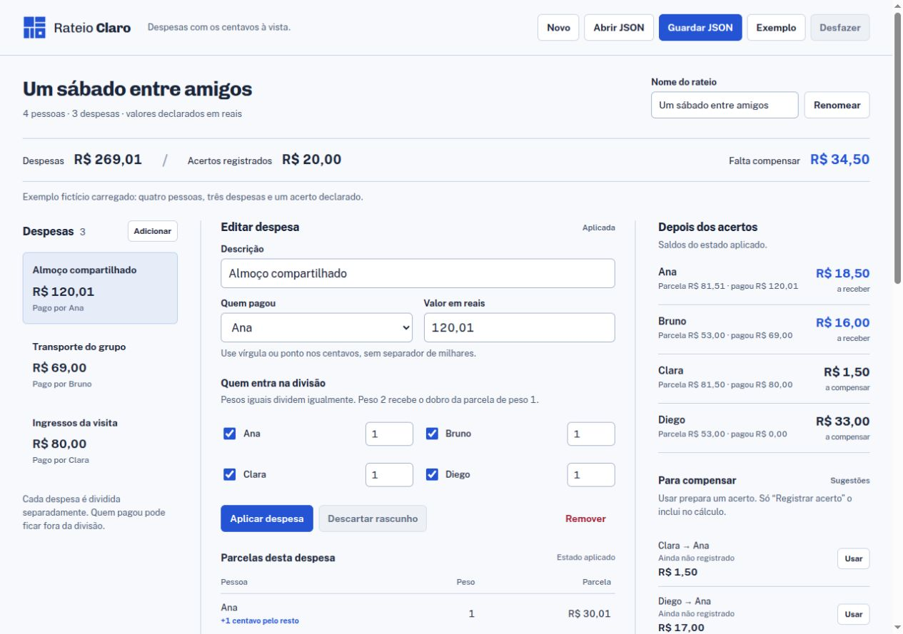

# Rateio Claro

Divida despesas de um grupo por pesos, confira o destino de cada centavo e registre os acertos que as pessoas declaram ter feito. O Rateio Claro mostra despesas, parcelas e saldos em português, com memória de cálculo exportável e arquivos locais para continuar depois.

O foco é o rateio de cada despesa e sua relação com os acertos. Um acerto reduz ou inverte saldos; ele não aumenta o custo do passeio. Sugestões ficam separadas dos registros e exigem uma ação explícita para virar acertos.

[Usar no navegador](https://martinlofranodeoliveira.github.io/rateio-claro/) · [Baixar versão 1.0.0](https://github.com/martinlofranodeoliveira/rateio-claro/releases/tag/v1.0.0) · [Como o cálculo funciona](docs/FORMATO.md)

Projeto aberto da [LOFRANO TECNOLOGIA](https://lofranotecnologia.com.br/), sob [licença MIT](LICENSE). O exemplo é fictício e autoral. Não há conta, integração bancária ou execução de pagamentos.



## Executar localmente

Use Node.js 22 ou 24 e npm. O aplicativo e o build não têm dependências de execução externas; não é necessário instalar pacotes npm.

```sh
git clone https://github.com/martinlofranodeoliveira/rateio-claro.git
cd rateio-claro
npm test
npm run build
npm run check
npm run dev
```

Abra [http://127.0.0.1:4173/](http://127.0.0.1:4173/). O servidor de desenvolvimento usa `dist/` quando esse diretório existe. Para acompanhar diretamente as fontes, execute `npm run dev -- --source`; outra porta pode ser escolhida com `--port 4174`. Encerre com `Ctrl+C`.

A distribuição é HTML, CSS, fontes locais e módulos JavaScript estáticos. O servidor acima serve apenas os arquivos durante o desenvolvimento. O build gera `dist/` a partir de uma lista fechada de arquivos e inclui um manifesto SHA-256. Consulte os passos e a evidência em [VERIFICACAO.md](docs/VERIFICACAO.md).

A [demonstração pública](https://martinlofranodeoliveira.github.io/rateio-claro/) usa o mesmo código estático. Os arquivos do site foram confrontados com o build local; a aquisição pelo Chrome está em [CONFERENCIA-NAVEGADOR.json](docs/CONFERENCIA-NAVEGADOR.json).

## Usar o rateio

1. Confira o exemplo ou escolha **Novo** e adicione as pessoas. Nomes iguais mantêm identidades distintas.
2. Adicione uma despesa, escolha quem pagou, marque os beneficiários e informe os pesos. Quem pagou pode ficar fora da divisão.
3. Confira a prévia das parcelas e use **Aplicar despesa**. Os saldos representam o estado aplicado.
4. Para declarar um acerto, confira quem enviou, quem recebeu e o valor, então use **Registrar acerto**. **Usar** uma sugestão apenas prepara o formulário.
5. Use **Guardar JSON** para salvar o estado aplicado. Para continuar, escolha **Abrir JSON** e selecione esse arquivo.

Use vírgula ou ponto para os centavos, sem símbolo de moeda, milhares ou notação exponencial. Por exemplo: `120`, `120,01` e `120.01`. Pesos são inteiros positivos: 1 e 2 representam proporção de um para dois.

Alterações ainda não aplicadas são rascunhos. A troca de despesa preserva seu rascunho; entradas inválidas conservam o projeto aplicado. Os relatórios ficam indisponíveis enquanto houver rascunhos. **Guardar JSON** continua disponível e salva somente o estado aplicado. O histórico de **Desfazer** conserva até 30 estados durante a sessão.

Não há salvamento automático, sincronização, telemetria nem armazenamento persistente do aplicativo. O cálculo e os arquivos não usam rede; a política `connect-src 'none'` bloqueia conexões do aplicativo. Ao fechar ou recarregar, a continuidade depende do JSON guardado. O navegador pode pedir confirmação de saída quando há trabalho pendente. Veja [PRIVACIDADE.md](docs/PRIVACIDADE.md).

## Como os centavos são distribuídos

Para cada despesa, o núcleo calcula `valor em centavos × peso ÷ soma dos pesos` com `BigInt`. Cada pessoa recebe a parte inteira; os centavos restantes vão para os maiores restos. Empates usam o ID estável em ordem ASCII. Uma pessoa recebe no máximo um centavo extra por despesa.

Separar ou juntar despesas pode mudar quem recebe o centavo de arredondamento. Não há rodízio por data ou histórico. A memória mostra numerador, denominador, base, resto e extra de cada parcela.

Saldo positivo significa **a receber**; negativo, **a pagar**. O cálculo é `pago − parcelas + enviado − recebido`. Sobrepagamentos declarados são preservados e podem inverter o saldo. As sugestões percorrem devedores e credores por ID; são determinísticas, sem promessa do menor número de transferências.

## Arquivos e limites

| Download | Para quê |
| --- | --- |
| `rateio-projeto.json` | Guardar e reabrir o projeto |
| `rateio-memoria.json` | Conferir os cálculos exatos, inclusive numeradores grandes como strings |
| `rateio-saldos.csv` | Consultar os valores por participante em centavos inteiros |
| `rateio-parcelas.csv` | Consultar pesos, bases, restos, extras e parcelas |
| `rateio-sugestoes.csv` | Consultar sugestões explicitamente não registradas |
| `rateio-relatorio.md` | Ler despesas, acertos e sugestões em um documento |

Somente o JSON de projeto é importável. CSV e Markdown são relatórios do estado aplicado. Textos CSV com líderes de fórmula recebem um apóstrofo; isso não muda os nomes e descrições no projeto JSON. Fórmulas e conversões de planilhas externas podem usar ponto flutuante; a memória JSON preserva os inteiros racionais exatos do núcleo.

São permitidos até 100 participantes, 500 despesas, 500 acertos e 100 beneficiários por despesa. O arquivo de projeto pode ter até 2 MiB de UTF-8. Valores e somas de cada coleção ficam limitados a 1.000.000.000.000 centavos; pesos individuais, a 1.000.000.000. Há somente BRL. Importações recusam BOM, UTF-8 inválido, chaves repetidas, campos inesperados e números JSON decimais ou exponenciais.

O [formato completo](docs/FORMATO.md) documenta o esquema, os limites e os cabeçalhos. A [verificação de interoperabilidade](docs/INTEROPERABILIDADE.md) distingue referências geradas por Node, downloads de navegador, leitura independente por Python e execuções registradas no LibreOffice.

## Código e verificação

O núcleo independente da interface está em [src/core.mjs](src/core.mjs). [src/io.mjs](src/io.mjs) cuida da importação e dos seis downloads; [src/app.mjs](src/app.mjs) mantém formulários, rascunhos e desfazer. O [exemplo](src/demo.mjs) gera a [fixture JSON](fixtures/demo-project.json) a partir de dados autorais, sem copiar dados de outra aplicação.

Os testes cobrem conservação de centavos, empates, pesos grandes, homônimos, acertos, sobrepagamentos, imutabilidade, importação estrita e relatórios. Um [consumidor Python independente](tools/check_downloads.py) reconstrói as parcelas com `Fraction`, sem importar o código JavaScript. Instruções reproduzíveis e limites de cada evidência estão em [VERIFICACAO.md](docs/VERIFICACAO.md) e [INTEROPERABILIDADE.md](docs/INTEROPERABILIDADE.md).

O código usa [MIT](LICENSE). As fontes locais mantêm suas licenças SIL Open Font License 1.1 e sua [proveniência](assets/FONTS.json).

## Contribuir

Sugira melhorias com um cenário fictício e o resultado esperado. Para alterações no cálculo ou nos arquivos, acrescente um caso que confronte o comportamento e execute os testes JavaScript e Python. O sistema visual está documentado em [DESIGN.md](DESIGN.md).
